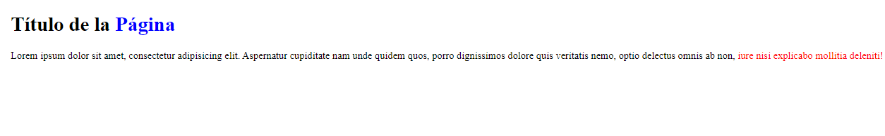
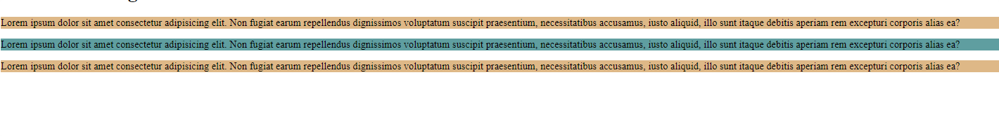
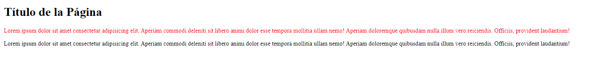

<h1 align="center">Selectores</h1>

<h2>📑 Contenido</h2>

- [¿Qué son los selectores?](#qué-son-los-selectores)
- [Selector universal](#selector-universal)
- [Selector de tipo](#selector-de-tipo)
- [Selector descendiente](#selector-descendiente)
- [Selector de Clase e ID](#selector-de-clase-e-id)
- [Selector de Atributo](#selector-de-atributo)
- [Selector Adyacente](#selector-adyacente)

## ¿Qué son los selectores?

Los selectores CSS son patrones que se utilizan para seleccionar y aplicar estilos a elementos HTML en una página web. Los selectores permiten a los diseñadores y desarrolladores web especificar qué elementos deben ser afectados por las reglas de estilo CSS que definen el aspecto y el diseño de una página.

## Selector universal

El selector universal `*` sirve para seleccionar todos los elementos. Mediante este selector podemos aplicar estilos a todos los elementos de la página.

Ejemplo:

```css
/* Aplicar un tamaño de fuente y un color a todos los elementos */
* {
  font-size: 20px;
  color: green;
}
```

## Selector de tipo

Los selectores de tipo seleccionan todos los elementos que pertenezcan a ese tipo concreto.
Si quieres aplicar estilos a todos los encabezados `<h1>` se puede usar el selector de tipo `h1{Declaraciones}`. En resumen, seleccionar por etiquetas HTML.
Se puede aplicar una misma regla para varios tipos de selectores separándoles con comas. `h1,h2,h3 {propiedad: valor;}`

Ejemplo:

```css
/* Aplicar un tamaño de fuente y un color a todos los elementos del body*/
body {
  font-size: 20px;
  color: green;
}

/* Aplicar bordes a todos los encabezados h1*/
h1 {
  border: 3px solid black;
}
```

## Selector descendiente

Los selectores descendiente seleccionan los elementos que se encuentran dentro de otros elementos. El estilo solo se aplicara a los elementos que se encuentren dentro del elemento padre.
Para seleccionar solo los hijos directos se puede usar el mayor que >(selector hijo) entre los selectores `p > span`.

Ejemplo:

Aplicar un color azul a todos los `<span>` y un color rojo a los que se encuentran dentro de un párrafo.

- **Selector descendiente:** con un espacio en blanco entre selectores.
  - `div p ` selecciona todos los párrafos que están dentro de un div, aunque haya otros elementos entre ellos.
- **Selector hijo:** con un mayor que > entre selectores.
  - `div > p` selecciona solo los párrafos que son hijos directos de un div, sin incluir los que están dentro de otros elementos.

```html
<h1>Título de la <span>Página</span></h1>

<p>
  Lorem ipsum dolor sit amet, consectetur adipisicing elit. Aspernatur
  cupiditate nam unde quidem quos, porro dignissimos dolore quis veritatis nemo,
  optio delectus omnis ab non,
  <span>iure nisi explicabo mollitia deleniti!</span>
</p>
```

```css
span {
  color: blue;
}
p span {
  color: red;
}
```

**Resultado:**



## Selector de Clase e ID

Los selectores de clase e Id sirven para agrupar e identificar elementos HTML y aplicar un estilo.
No se puede usar el mismo nombre para varios ids.
Se puede usar los selectores descendientes con clases e ids. Para las clases se usa un . delante del nombre y para los id se usa # delante del nombre.

Sintaxis(HTML):<br>
`<h1 class="nombre-de-la-clase">Título de la Página</h1>`

`<h1 id="nombre-del-id">Título de la Página</h1>`

Sintaxis(CSS): <br>
`.nombre-de-la-clase{ propiedad: valor}`

`#nombre-del-id{ propiedad: valor}`

> [!NOTE]
>
> - Las clases se pueden aplicar a varios elementos, el ID no.
> - Los ID tienen mayor especificidad que las clases.
> - Selector de Clase = .
> - Selector de Id = #

Ejemplo:

```html
<!-- HTML -->
<p class="parrafos_secundarios">
  Lorem ipsum dolor sit amet consectetur adipisicing elit. Non fugiat earum
  repellendus dignissimos voluptatum suscipit praesentium, necessitatibus
  accusamus, iusto aliquid, illo sunt itaque debitis aperiam rem excepturi
  corporis alias ea?
</p>

<p id="parrafos_principal">
  Lorem ipsum dolor sit amet consectetur adipisicing elit. Non fugiat earum
  repellendus dignissimos voluptatum suscipit praesentium, necessitatibus
  accusamus, iusto aliquid, illo sunt itaque debitis aperiam rem excepturi
  corporis alias ea?
</p>

<p class="parrafos_secundarios">
  Lorem ipsum dolor sit amet consectetur adipisicing elit. Non fugiat earum
  repellendus dignissimos voluptatum suscipit praesentium, necessitatibus
  accusamus, iusto aliquid, illo sunt itaque debitis aperiam rem excepturi
  corporis alias ea?
</p>
```

```css
/* CSS */
#parrafos_principal {
  background-color: cadetblue; /*Azul*/
}

.parrafos_secundarios {
  background-color: burlywood; /*Marron*/
}
```

**Resultado:**



## Selector de Atributo

El selector de Atributo permite seleccionar elementos en función de su atributo o el valor del atributo.

Sintaxis:<br>
selector[atributo="valor"]{propiedad: valor}

**Caracteres para ser mas específicos:**

Sintaxis:<br>
selector[atributo**carácter**="valor"]{propiedad: valor}

- (\*) --> Todos los elementos que contengan ese valor.
- (^) --> Todos los elementos que empiezan por ese valor.
- ($) --> Todos los elementos que terminan por ese valor.
- (~) --> Buscar un valor sin importar si esta separado por espacios.
- (i o I) --> Para evitar distinguir valores en mayúsculas o minúsculas. Agregar antes del corchete de cierre.
- (s o S) --> Para distinguir valores en mayúsculas o minúsculas. Agregar antes del corchete de cierre.

Ejemplos:

```html
<!-- Enlaces -->
<a href="informacion.html">Información</a>
<a href="blog.html">Blog</a>
<a href="contactos.php">Contactos</a>
```

```css
/* CSS */

/* Cambiar el color(rojo) a todos los enlaces que tengan el atributo. */
a[href] {
  color: red;
}
/* Cambiar el color(azul) a todos los enlaces que contengan el valor `href="blog.html"`. */
a[href="blog.html"] {
  color: blue;
}
/* Cambiar el color(verde) a todos los enlaces que terminen con .php */
a[href$=".php"] {
  color: green;
}
```

## Selector Adyacente

Los selectores adyacentes (+) seleccionan solo los elementos que van precedidos por el primer elemento.

```html
<!-- HTML -->
<h1>Título de la Página</h1>

<p>
  Lorem ipsum dolor sit amet consectetur adipisicing elit. Aperiam commodi
  deleniti sit libero animi dolor esse tempora mollitia ullam nemo! Aperiam
  doloremque quibusdam nulla illum vero reiciendis. Officiis, provident
  laudantium!
</p>

<p>
  Lorem ipsum dolor sit amet consectetur adipisicing elit. Aperiam commodi
  deleniti sit libero animi dolor esse tempora mollitia ullam nemo! Aperiam
  doloremque quibusdam nulla illum vero reiciendis. Officiis, provident
  laudantium!
</p>
```

```css
/* CSS */
h1 + p {
  color: red;
}
```

**Resultado:**




