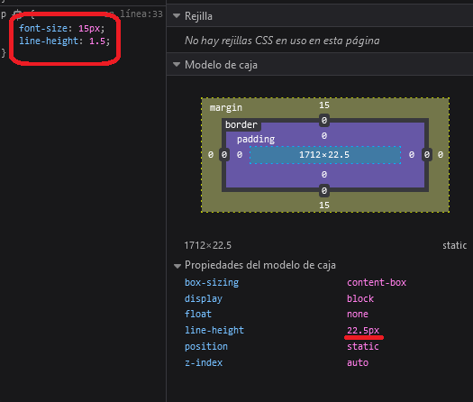
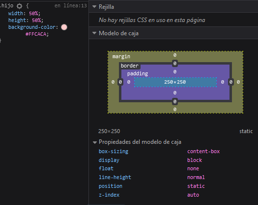

<h1 align="center">Unidades de Medida</h1>

<h2>📑 Contenido</h2>

- [Números](#números)
- [Porcentajes](#porcentajes)
- [Dimensiones y longitudes](#dimensiones-y-longitudes)
  - [Longitudes absolutas](#longitudes-absolutas)
  - [Longitudes relativa](#longitudes-relativa)
  - [Dimensiones dinámicas del viewport](#dimensiones-dinámicas-del-viewport)

## Números

Los números se utilizan para asignar valor al `line-height`(establece la distancia entre líneas de texto), `opacity`(transparencia) y colores `rgb`. En el caso de `line-height` el valor que se utilice es x veces el tamaño de la letra. Si utilizamos un tamaño de fuente de 15 px y un `line-height` de 1.5 este seria el 150% de 15px = 22.5px. La opacidad o transparencia va desde 0 hasta 1, siendo 1 lo más "oscuro".

Ejemplo `line-height`.



## Porcentajes

Al usar un valor en forma de porcentaje es importante saber que el % esta relacionado con su padre.

Ejemplo:

```html
<div class="padre">
  <div class="hijo"></div>
</div>
```

```css
.padre {
  width: 500px;
  height: 500px;
  background-color: #251b37;
}

.hijo {
  width: 50%;
  height: 50%;
  background-color: #ffcaca;
}
```



> [!WARNING]
>
> El hijo tendrá un tamaño de 250x250 la mitad del ancho y alto del padre. <br>
> No hereda el tamaño del padre, es un elemento en bloque y ocupa todo el espacio(ancho) disponible.

## Dimensiones y longitudes

Las dimensiones se crean al juntar una unidad con un número. Las longitudes son dimensiones que se refieren a la distancia y pueden ser absolutas o relativas.

### Longitudes absolutas

Las longitudes absolutas se resuelven contra la misma base, se podría decir que no varían el tamaño.

Algunas unidades:

- **Píxeles (px)** ==> 1px = 1/96 de 1in
- **Centímetros (cm)** ==> 1cm = 96px/2,54
- **Milímetros (mm)** ==> 1mm = 1/10 de 1cm
- **Pulgadas (in)** ==> 1in = 2,54cm = 96px
- **Puntos (pt)** ==> 1pt = 1/72 de 1in

> [!NOTE]
>
> El valor que más se usa en pantalla son los Píxeles. El resto de unidades son para formatos impresos.

### Longitudes relativa

Estas unidades son relativas a algo, se calculan contra un valor base. El tamaño de la ventana, el tamaño del elemento padre, tamaño de la letra...
Como se pueden dimensionar, nos facilitan el trabajo a la hora de hacer un diseño web adaptable.

Algunas unidades:

- **em** calcula el tamaño en base al padre. 1.5em será un 50% más grande que el padre.
- **rem** calcula el tamaño en base de la raíz(root). Por defecto es 16px.
- **Viewport**: Unidades relativas a la ventana.
  - **vw** 1% de la anchura de la ventana gráfica.
  - **vh** 1% de la altura de la ventana gráfica.
  - **vmin** 1% de la dimensión más pequeña de la ventana gráfica.
  - **vmax** 1% de la dimensión más grande de la ventana gráfica.

---

### Dimensiones dinámicas del viewport

Si queremos ceñirnos al tamaño que haya en cada momento en función de si se ven o no los elementos como puede ser un teclado flotante. Podemos utilizar unidades dinámicas del viewport, que son equivalentes a las que acabamos de ver pero con el prefijo dv delante `dvw, dvh, dvi, dvb, dvmin y dvmax`.

En este caso los valores de estas unidades coinciden con las del área visible de la página. Es decir, si los elementos del navegador están ocultos coinciden con las dimensiones del viewport grande. Y si los elementos del navegador se muestran, entonces coinciden con los valores de las unidades del viewport pequeño.


