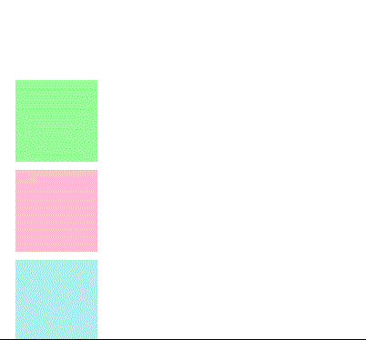

<h1 align="center">Visibilidad</h1>

<h2>📑 Contenido</h2>

- [Visibilidad](#visibilidad)
  - [display](#display)
  - [visibility](#visibility)

## Visibilidad

Al ocultar un elemento este puede afectar a la posición que ocupa. Puede que el elemento este oculto pero que su espacio que ocupa siga presente en la página. Las dos maneras más usadas para ocultar los elementos son las propiedades `display` y `visibility`.

Ejemplo sin aplicar valores:

### display

Aplicando el valor none. El Elemento no sera visible ni ocupara espacio en el documento.

### visibility

Aplicando el valor hidden. El elemento no sera visible pero si ocupara espacio en el documento.

