<h1 align="center">Mover Horizontal y Vertical</h1>

<h2>📑 Contenido</h2>

- [Mover Horizontal y Vertical](#mover-horizontal-y-vertical)
  - [**justify-content**](#justify-content)
    - [Ejemplos(Eje principal Row):](#ejemploseje-principal-row)
    - [Ejemplos(Eje principal Column):](#ejemploseje-principal-column)
  - [**align-items**](#align-items)
    - [Ejemplos(Eje principal Row):](#ejemploseje-principal-row-1)
    - [Ejemplos(Eje principal Column):](#ejemploseje-principal-column-1)

## Mover Horizontal y Vertical

Para mover los items es importante tener en cuenta el eje principal.

### **justify-content**

Con `justify-content` movemos el **eje principal** de forma horizontal.

> Sintaxis: `justify-content: flex-start | flex-end | center | space-between | space-around | space-evenly | start | end | left | right`

#### Ejemplos(Eje principal Row):

**Código**

```html
<!-- HTML -->
<div class="flex-container">
  <div class="flex-item">1 item</div>
  <div class="flex-item">2 item</div>
  <div class="flex-item">3 item</div>
  <div class="flex-item">4 item</div>
  <div class="flex-item">5 item</div>
</div>
```

```css
/* CSS */
.flex-container {
  width: 400px;
  height: 300px;
  margin: 15% auto;
  display: flex;
  gap: 5px;
  flex-direction: row;
  justify-content: flex-start;
  background-color: #937dc2;
}

.flex-item {
  width: 50px;
  height: 50px;
  padding: 3px;
  font-size: 20px;
}
.flex-item:nth-child(even) {
  background-color: #9fc9f3;
}

.flex-item:nth-child(odd) {
  background-color: #ff9494;
}
```

---

**Flex-Start(por defecto)**

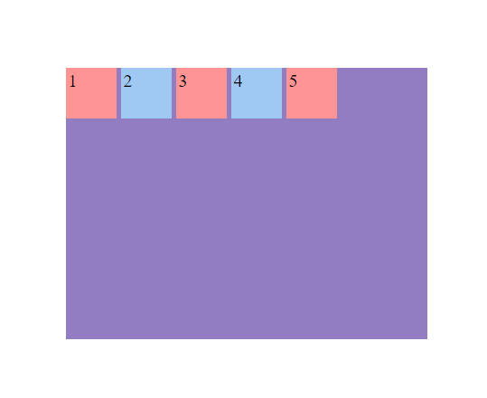

---

**Center**

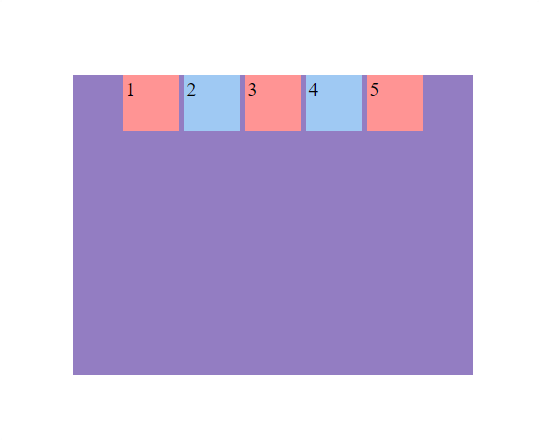

---

**Flex-End**

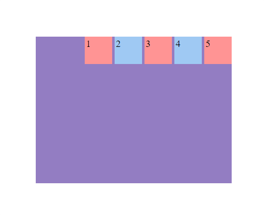

---

**Space-Between**

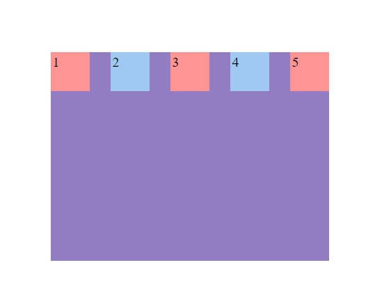

---

**Space-Around**

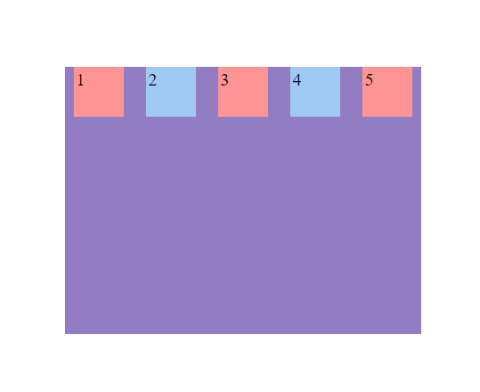

---

**Space-Evenly**

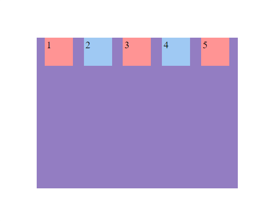

> [!NOTE]
>
> La diferencia entre evenly y around es cómo se distribuye el espacio en los extremos del contenedor. Space-around deja menos espacio en los extremos en comparación con el espacio entre los elementos.

---

#### Ejemplos(Eje principal Column):

**Código**

```html
<!-- HTML -->
<div class="flex-container">
  <div class="flex-item">1 item</div>
  <div class="flex-item">2 item</div>
  <div class="flex-item">3 item</div>
  <div class="flex-item">4 item</div>
  <div class="flex-item">5 item</div>
</div>
```

```css
/* CSS */
.flex-container {
  width: 400px;
  height: 300px;
  margin: 15% auto;
  display: flex;
  gap: 5px;
  flex-direction: column;
  justify-content: flex-start;
  background-color: #937dc2;
}

.flex-item {
  width: 50px;
  height: 50px;
  padding: 3px;
  font-size: 20px;
}
.flex-item:nth-child(even) {
  background-color: #9fc9f3;
}

.flex-item:nth-child(odd) {
  background-color: #ff9494;
}
```

**Flex-Start(por defecto)**

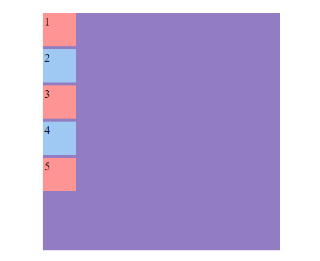

---

**Center**

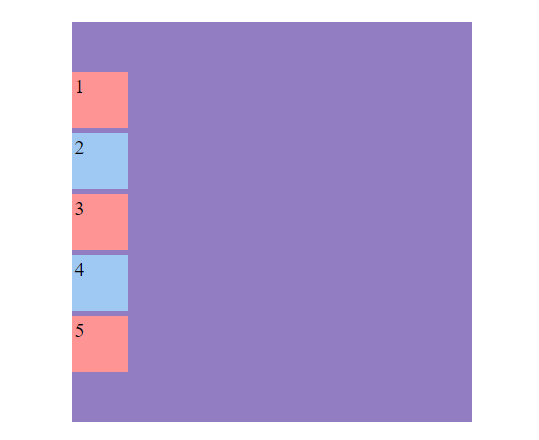

---

**Flex-End**

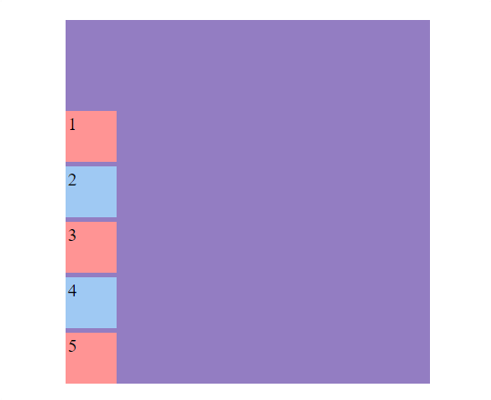

---

**Space-Between**


---

**Space-Around**

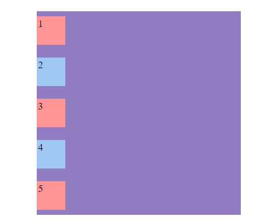

---

**Space-Evenly**

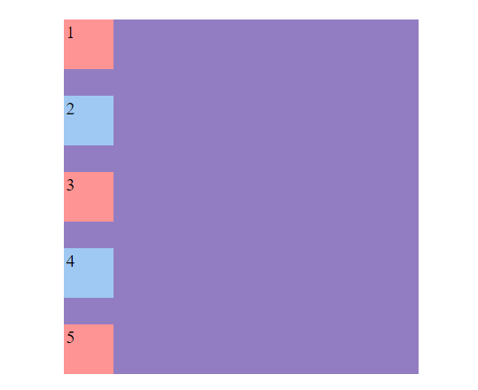

---

### **align-items**

Con `align-items` movemos el **eje principal** de forma vertical.

> Sintaxis: `align-items: stretch | flex-start | flex-end | center | baseline | first baseline | last baseline | start | end;`

#### Ejemplos(Eje principal Row):

**Código**

```html
<!-- HTML -->
<div class="flex-container">
  <div class="flex-item">1 item</div>
  <div class="flex-item">2 item</div>
  <div class="flex-item">3 item</div>
  <div class="flex-item">4 item</div>
  <div class="flex-item">5 item</div>
</div>
```

```css
/* CSS */
.flex-container {
  width: 400px;
  height: 400px;
  margin: 15% auto;
  display: flex;
  gap: 5px;
  flex-direction: row;
  align-items: flex-start;
  background-color: #937dc2;
}

.flex-item {
  width: 50px;
  height: 50px;
  padding: 3px;
  font-size: 20px;
}
.flex-item:nth-child(even) {
  background-color: #9fc9f3;
}

.flex-item:nth-child(odd) {
  background-color: #ff9494;
  height: 80px;
}
```

---

**Flex-Start(por defecto)**

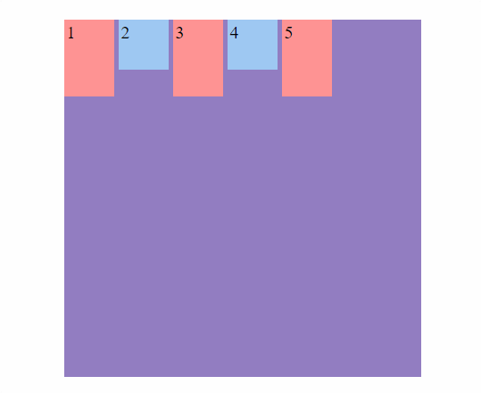

---

**Center**

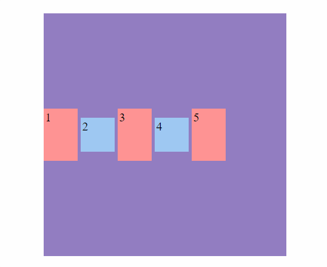

---

**Flex-End**

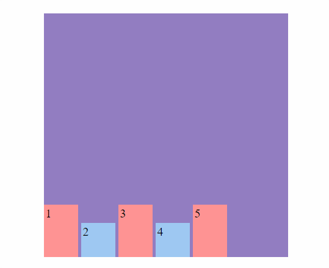

---

**Baseline**


---

**Stretch**


---

#### Ejemplos(Eje principal Column):

**Código**

```html
<!-- HTML -->
<div class="flex-container">
  <div class="flex-item">1 item</div>
  <div class="flex-item">2 item</div>
  <div class="flex-item">3 item</div>
  <div class="flex-item">4 item</div>
  <div class="flex-item">5 item</div>
</div>
```

```css
/* CSS */
.flex-container {
  width: 400px;
  height: 400px;
  margin: 15% auto;
  display: flex;
  gap: 5px;
  flex-direction: column;
  align-items: flex-start;
  background-color: #937dc2;
}

.flex-item {
  width: 50px;
  height: 50px;
  padding: 3px;
  font-size: 20px;
}
.flex-item:nth-child(even) {
  background-color: #9fc9f3;
}

.flex-item:nth-child(odd) {
  background-color: #ff9494;
  width: 80px;
}
```

---

**Flex-Start(por defecto)**


---

**Center**

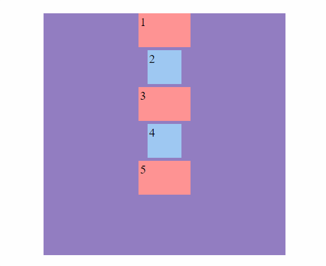

---

**Flex-End**

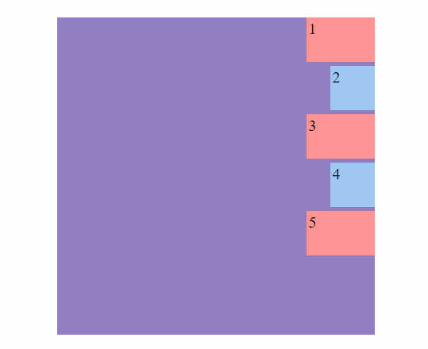

---

**Baseline**

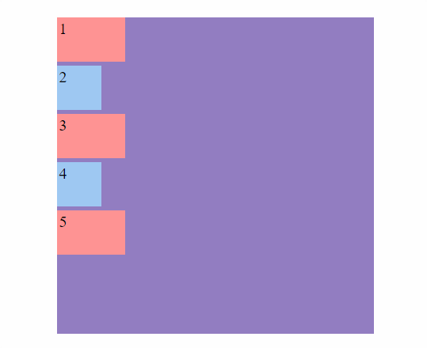

---

**Stretch**


