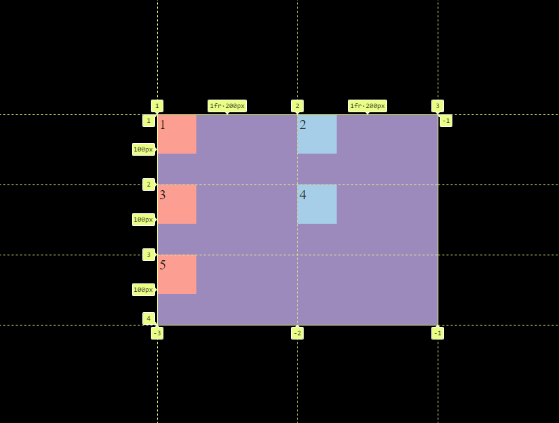

<h1 align="center">Columnas y Filas</h1>

<h2>📑 Contenido</h2>

- [Columnas y Filas](#columnas-y-filas)
  - [Ejemplo: Grid de 2 columnas-filas iguales](#ejemplo-grid-de-2-columnas-filas-iguales)

## Columnas y Filas

Para asignar un numero de columnas o filas usaremos las propiedades `grid-template-columns` y `grid-template-rows`. Los valores que le pasaremos a estas propiedades serán lo que queremos que ocupen las columnas o filas. Si queremos 3 columnas, que la primera ocupe 150px, la segunda 300px y la tercera 150px tendríamos que hacer lo siguiente: `grid-template-columns: 150px 300px 150px`. Ademas de px también aceptan porcentajes, em, rem, cm... Prácticamente cualquier unidad de medida, una unidad muy util en grid son las fracciones(fr). Si queremos 3 columnas que ocupen lo mismo, podemos utilizar `grid-template-columns: 1fr 1fr 1fr`.

> [!IMPORTANT]
>
> Las filas y columnas no se crean en función de los hijos/elementos que tenga. Se pueden crear columnas y filas vacías.

### Ejemplo: Grid de 2 columnas-filas iguales

```html
<!-- HTML -->
<div class="grid-container">
  <div class="grid-item">1</div>
  <div class="grid-item">2</div>
  <div class="grid-item">3</div>
  <div class="grid-item">4</div>
  <div class="grid-item">5</div>
</div>
```

```css
/* CSS */

.grid-container {
  width: 400px;
  height: 300px;
  margin: 15% auto;
  display: grid;
  grid-template-columns: 1fr 1fr;
  background-color: #937dc2;
}

.grid-item {
  width: 50px;
  height: 50px;
  padding: 3px;
  font-size: 20px;
}
.grid-item:nth-child(even) {
  background-color: #9fc9f3;
}

.grid-item:nth-child(odd) {
  background-color: #ff9494;
}
```

Resultado:



> [!TIP]
>
> Para evitar tener que repetir el valor de cada columna-fila podemos usar repeat(numColumnas-filas, unidad de medida). <br> ` grid-template-columns: repeat(2,1fr);` El resultado es el mismo.
