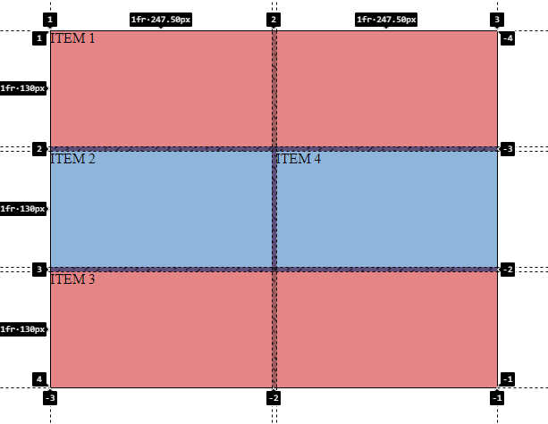

<h1 align="center">Líneas Inicio y Fin</h1>

<h2>📑 Contenido</h2>

- [Líneas inicio y fin](#líneas-inicio-y-fin)
- [Ejemplo](#ejemplo)

## Líneas inicio y fin

Usaremos las líneas como referencia para indicar donde empiezan y terminan las columnas y las filas. Con `grid-column-start y grid-column-end` indicaremos el inicio y el final de las columnas, para las filas usaremos `grid-row-start y grid-row-end`. Estas propiedades tienen una version abreviada, `grid-column: inicio / fin;` y `grid-row: inicio / final;`.

## Ejemplo

```html
<!-- HTML -->
<div class="wrapper">
  <div class="grid-item">ITEM 1</div>
  <div class="grid-item">ITEM 2</div>
  <div class="grid-item">ITEM 3</div>
  <div class="grid-item">ITEM 4</div>
</div>
```

```css
/* CSS */

.wrapper {
  width: 500px;
  height: 400px;
  background-color: #937dc2;
  display: grid;
  grid-template-columns: 1fr 1fr;
  grid-template-rows: 1fr 1fr 1fr;
  gap: 5px;
}
.grid-item:nth-child(even) {
  background-color: #9fc9f3;
}

.grid-item:nth-child(odd) {
  background-color: #ff9494;
}
.grid-item:nth-child(1) {
  grid-column: 1/3;
}
.grid-item:nth-child(3) {
  grid-column: 1/3;
  grid-row: 3/4;
}
```

Resultado:


