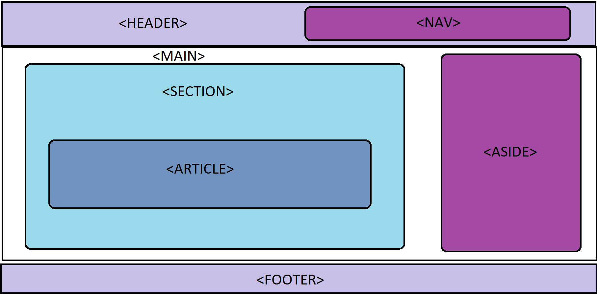

<h1 align="center">Estructural</h1>

<h2>📑 Contenido</h2>

- [Estructural](#estructural)
- [Elementos Semánticos Estructurales Clave en HTML](#elementos-semánticos-estructurales-clave-en-html)
- [Atributo Rol](#atributo-rol)

## Estructural

La semántica estructural en HTML se centra en el uso de etiquetas que describen el propósito y la estructura del contenido, en lugar de simplemente definir cómo se verá visualmente. Esta práctica permite a los desarrolladores, navegadores, motores de búsqueda y tecnologías asistivas entender mejor el contenido de una página web y cómo está organizado.

## Elementos Semánticos Estructurales Clave en HTML

- **`<header>`** Se utiliza para definir la cabecera la página web o de una sección.
- **`<nav>`** Se utiliza para definir la navegación de la web.
- **`<main>`** Se usa para definir el contenido principal del documento.
  - Se suele usar uno por documento.
  - No poner dentro contenido que se repita(Headers,Nav,Footer...).
  - Evitar incluir los main dentro de otra caja.
- **`<section>`** Se utiliza para representar una sección genérica de un documento.
- **`<article>`** Se utiliza para representar secciones que no sean genéricas, a modo de artículos independientes como en las revistas.
- **`<aside>`** Se utiliza para alojar el contenido que tiene menos importancia de la web.
- **`<footer>`** Se utiliza para definir el pie de la pagina o de una sección(autor, fecha, copyright, enlaces...).
- **`<template>`** Esta etiqueta evita el renderizado de cierto contenido al cargar una pagina. Las plantillas `<template>` se ejecutan empleando **JavaScript**.

> [!NOTE]
>
> Estos elementos semánticos ayudan a estructurar el código de manera más significativa y proporcionan pistas importantes sobre la intención y la relación del contenido en una página web. Además, facilitan la accesibilidad y la indexación de los motores de búsqueda.

> [!TIP]
>
> Si el primer elemento hijo de un `<section>` es un encabezado(`<h1>...<h6>`) suele ser señal de que esta bien empleado. A no ser que sea el contenido principal, en ese caso utilizar `<main>`.

Ejemplo:



> [!WARNING]
>
> No es la única formación hay muchas combinaciones posibles. El nav bajo el header , el aside a la izquierda...

> [!TIP]
>
> También se puede agregar más información semántica utilizando `<figure>` y `<figcaption>` para las [imágenes](./06-Imagenes.md) y `<fieldset>` si para agrupar información relacionada en los [formularios](./05-Formularios.md).

## Atributo Rol

El atributo **role** es utilizado para proporcionar información adicional sobre el propósito y la función de un elemento, especialmente en el contexto de la accesibilidad web. Este atributo se utiliza para asignar roles semánticos a elementos que no poseen un significado semántico específico por sí mismos.

Algunos elementos HTML ya tienen roles semánticos incorporados (por ejemplo, `<button>` tiene implícitamente el rol de "botón"), pero en casos en los que necesitas asignar un rol adicional o modificar el comportamiento predeterminado, puedes utilizar el atributo role.

```html
<div role="alert">
  <p>¡Atención! Este es un mensaje importante.</p>
</div>
```

> [!IMPORTANT]
>
> Es importante usar el atributo role con moderación y de manera apropiada, ya que su uso excesivo o incorrecto podría afectar negativamente la accesibilidad y comprensión del contenido por parte de los usuarios. Evitar usar rol para elementos existentes de forma nativa.
