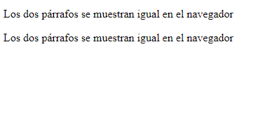
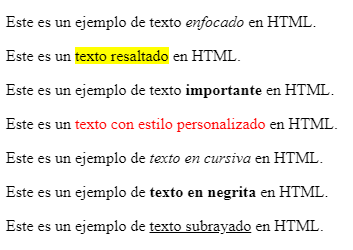
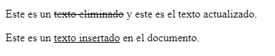

<h1 align="center">Párrafos</h1>

<h2>📑 Contenido</h2>

- [Párrafos](#párrafos)
- [Resaltar texto](#resaltar-texto)
- [Contenido Eliminado o Insertado](#contenido-eliminado-o-insertado)
- [¿Qué son los enlaces?](#qué-son-los-enlaces)
- [Rutas](#rutas)
- [Enlaces Internos](#enlaces-internos)
- [Enlaces Externos](#enlaces-externos)
- [Enlaces Anclas](#enlaces-anclas)
- [Imágenes con Enlaces](#imágenes-con-enlaces)
- [Enlaces para Correos](#enlaces-para-correos)
- [Enlaces para Descargas](#enlaces-para-descargas)
- [Base](#base)

## Párrafos

Para insertar un párrafo se utiliza la etiqueta `<p>`

`<p>Esto es texto de relleno</p>`

- Los párrafos se comportan en forma de bloque.
- Los párrafos pueden contener otras etiquetas.
  `<a>,<span>,<strong>,<small>,<mark>...`
- Para hacer un salto de línea dentro de un párrafo se puede utilizar la etiqueta `<br>`
- Los saltos de línea( Con Enter <-| ) y el exceso de espacio en blanco o tab dentro de un párrafo no son visibles en el navegador.
- Si quieres que te detecte los saltos de línea se puede usar la etiqueta `<pre></pre>` para mostrar el código tal cual.

**Ejemplo**

```HTML
<!--  saltos de línea -->
 <p>
      Los
      dos
      párrafos
      se
      muestran
      igual
      en
      el
      navegador
    </p>

    <p>Los dos párrafos se muestran igual en el navegador</p>
```

**Resultado:**



> [!TIP]
>
> Si quieres hacer un salto de línea dentro de un párrafo utiliza la etiqueta `<br>`. <br>
> También se puede utilizar `<wbr>` para sugerir un salto de línea donde el navegador decide dividir la palabra.
>
> - `<br>` Fuerza el sato de línea
> - `<wbr>` Sugiere al navegador un sato de línea

## Resaltar texto

Para editar un texto concreto, ya sea para enfatizar, resaltar, subrayar... Se pueden utilizar varias etiquetas y no recurrir al CSS.

> [!IMPORTANT]
>
> No utilizar estas etiquetas para dar estilos, para dar estilos a la web se utiliza CSS. Estas etiquetas se usan para agregar contenido mas haya de lo estético. Enfatizar un párrafo, resaltar o subrayar un texto como importante,
> advertir al lector de que una palabra o una frase puede no resultarle familiar, ya sea porque es extranjera o porque forma parte de una jerga o argot.

**Etiquetas más comunes para dar formato:**

- `<em>`: se utiliza para enfatizar o resaltar texto dentro de un párrafo o una sección de texto.
- `<mark>`: se utiliza para resaltar o destacar parte del texto en un color de fondo amarillo por defecto, lo que puede ser personalizado mediante CSS.
- `<strong>`: se utiliza para dar un énfasis más fuerte al texto, lo que generalmente se traduce en hacer que el texto sea más importante o destacado.
- `<span>`:se utiliza como un contenedor genérico para aplicar estilos o scripts a partes específicas del texto.No tiene ningún efecto visual por sí misma.
- `<i>`: se utiliza para mostrar texto en cursiva.
- `<b>`: se utiliza para mostrar texto en negrita.
- `<u>`: se utiliza para mostrar texto subrayado.

```HTML
<!-- Ejemplos -->
<p>Este es un ejemplo de texto <em>enfocado</em> en HTML.</p>

<p>Este es un <mark>texto resaltado</mark> en HTML.</p>

<p>Este es un ejemplo de texto <strong>importante</strong> en HTML.</p>

<p>Este es un <span>texto con estilo personalizado</span> en HTML.</p>

<p>Este es un ejemplo de <i>texto en cursiva</i> en HTML.</p>

<p>Este es un ejemplo de <b>texto en negrita</b> en HTML.</p>

<p>Este es un ejemplo de <u>texto subrayado</u> en HTML.</p>
```

**Resultado:**



## Contenido Eliminado o Insertado

Con las etiquetas `<del>` e `<ins>` podemos representar contenido eliminado o insertado, respectivamente.

- `<del>`(Deleted Text): Se utiliza para representar texto que ha sido eliminado o eliminado de una versión anterior del documento.
- `<ins>`(Inserted Text): Se utiliza para representar texto que ha sido insertado o añadido en una versión posterior del documento.

```html
<!-- HTML -->
<p>Este es un <del>texto eliminado</del> y este es el texto actualizado.</p>
<p>Este es un <ins>texto insertado</ins> en el documento.</p>
```

**Resultado:**




<h1 align="center">Enlaces</h1>

<h2>📑 Contenido</h2>

- [Párrafos](#párrafos)
- [Resaltar texto](#resaltar-texto)
- [Contenido Eliminado o Insertado](#contenido-eliminado-o-insertado)
- [¿Qué son los enlaces?](#qué-son-los-enlaces)
- [Rutas](#rutas)
- [Enlaces Internos](#enlaces-internos)
- [Enlaces Externos](#enlaces-externos)
- [Enlaces Anclas](#enlaces-anclas)
- [Imágenes con Enlaces](#imágenes-con-enlaces)
- [Enlaces para Correos](#enlaces-para-correos)
- [Enlaces para Descargas](#enlaces-para-descargas)
- [Base](#base)

## ¿Qué son los enlaces?

Los enlaces permiten navegar por la página, vincular documentos o recursos tanto internos como externos.

Para crear enlaces en HTML se utiliza la etiqueta: <br>
`<a href="ruta_del_enlace">Texto que se muestra</a>`

## Rutas

Antes de explicar el funcionamiento de los enlaces y sus tipos es importante saber como funcionan las rutas. **Las rutas especifican la dirección en la que se encuentran ubicados los archivos**.
Existen dos tipos de rutas:

- **Rutas Absolutas:** Las rutas absolutas indican todas las carpetas que hay entre el tipo de enlace `http:`(Protocolo de transferencia de hipertexto) hasta el archivo que queremos.
  - `tipo-de-enlace://dominio/directorio/archivo.html`
  - `http://www.midomino.com/informacion/contactos.html`
- **Rutas Relativas:** Las rutas relativas no necesitan la ubicación completa.
  - ./ Ruta actual.
  - / Desde la raíz.
  - ../ Moverse a un nivel superior(Ir hacia atrás).
  - imagen.png si solo esta el nombre + la extension significa que se encuentra en el mismo directorio.

## Enlaces Internos

Los enlaces internos apuntan o enlazan subpáginas o páginas web que se encuentren en el mismo dominio que la página principal.

Sintaxis: <br>
` <a href="contactos.html">Contáctenos</a>`

**Arquitectura de directorios:**

- Web
  - index.html
  - contactos.html
  - nosotros.html
- PDF
  - nosotros.pdf

```HTML
<!-- Supongamos que desde el archivo index.html queremos crear un enlace para contactos.html -->

<a href="contactos.html">Contáctenos</a>

<!-- Supongamos que desde el archivo index.html queremos crear un enlace para nosotros.pdf -->

<a href="../PDF/nosotros.pdf">Sobre Nosotros</a>
```

## Enlaces Externos

Los enlaces externos crean hipervínculos hacia dominios externos. Páginas web que no se encuentran en el mismo dominio que la página principal.
Para usar enlaces externos es necesario usar rutas absolutas.

Sintaxis: <br>
` <a href="https://google.com" target="_blank">Ir a Google</a>`

> [!NOTE]
>
> El atributo target="\_blank" sirve para abrir el enlace en otra pestaña del navegador.

Atributos a tener en cuenta con los enlaces externos:

- `rel=”noopener”` le dice al navegador que no use window.opener de javascript.
- `rel=“noreferrer”` evita que el navegador recopile información sobre la página principal.
- `rel=nofollow` evita que los bots rastreadores tengan en cuenta dicho enlace. La página que recibe el enlace no se beneficia de la página origen.

## Enlaces Anclas

Los enlaces ancla sirven para enlazar el contenido que este en el mismo documento.
Para vincular un enlace con un elemento del documento es necesario establecer un id para dicho elemento. El enlace lleva el nombre del id al que se quiere anclar con un # delante.

Sintaxis: <br>
`<a href="#ID-del-Elemento">texto del enlace</a>` > `<hq id="ID-del-Elemento">Encabezado</hq>`

```html
<!-- Ejemplo: Enlace al final de la web para subir arriba al pulsar -->

<h1 id="subir">Titulo principal</h1>

<!--
    Contenido
    de
    la
    página
    web
-->

<a href="#subir">Pulsa para ir al principio</a>
```

## Imágenes con Enlaces

Las imágenes se pueden enlazar y que a la hora de hacer click sobre ellas se ejecute el enlace.

```html
<!-- Ejemplo de una Imagen con un Enlace -->

<a href="https://unsplash.com/es/fotos/JW-T2BH5k5E">
  
</a>
```

## Enlaces para Correos

HTML permite que con un simple enlace "mailto:" se abra tu cliente de correo favorito ya con todo preparado para enviar el email. Se usa para que el usuario se comunique contigo, no sirve para enviar correos al usuario.

> [!CAUTION]
>
> El correo que se pone en mailto: es el correo del **destinatario**.

```html
<!-- Ejemplo de un enlace mailto: -->

<a href="mailto:correo@dominio.com">Consúltenos a correo@dominio.com</a>
```

## Enlaces para Descargas

Haciendo uso del atributo **download** podemos descargar archivos del servidor de forma automática.

```html
<!-- Ejemplo enlace para descargar Navegador-Firefox -->

<a
  href="https://download.mozilla.org/?product=firefox-latest-ssl&os=win64&lang=es-MX"
  download="firefox-latest-64bit-installer.exe"
>
  Descarga la última versión de Firefox para Windows (64 bits) (Español, es-MX)
</a>

<!-- Ejemplo de enlace de descarga PDF interno-->
<a href="documento.pdf" download>Descargar documento PDF</a>
```

> [!TIP]
>
> Se puede descargar una imagen si la anidamos con un enlace y la propiedad download(Las imágenes tienen que estar en tu dominio).
>
> ```html
> <a download href="img/imagen.jpg">
>   
> </a>
> ```
>
> Al hacer click en la imagen se descargara o te pedirá donde guardarla.

## Base

Si en tu web tienes varios enlaces que apuntan al mismo dominio mediante la etiqueta `<base>`, podemos optimizar y enlazar de manera más fácil la ruta del enlace.
**También se puede utilizar con imágenes**.

```html
<!-- Ejemplo base -->

<!DOCTYPE html>
<html lang="es">
  <head>
    <meta charset="UTF-8" />
    <meta name="viewport" content="width=device-width, initial-scale=1.0" />
    <title>Base</title>
    <base
      href="https://es.wikipedia.org/wiki/Tabla_peri%C3%B3dica_de_los_elementos"
    />
  </head>
  <body>
    <h1>Tabla Periódica</h1>
    <a href="">Hidrógeno</a>
    <a href="">Litio</a>
    <a href="">Renio</a>
    <a href="">Molibdeno</a>
  </body>
</html>
```


