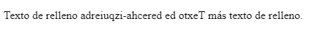

<h1 align="center">Dirección de Texto</h1>

<h2>📑 Contenido</h2>

- [Dirección de Texto](#dirección-de-texto)
  - [`<bdi>`](#bdi)
  - [`<bdo>`](#bdo)

## Dirección de Texto

Las etiquetas `<bdi>` y `<bdo>` se utilizan para manejar la dirección del texto dentro de un documento web. Estas etiquetas son especialmente útiles cuando se trabaja con idiomas que se escriben de derecha a izquierda (como árabe o hebreo) o cuando se necesita controlar la dirección del texto en un fragmento específico de una página web.

### `<bdi>`

La etiqueta `<bdi>` se utiliza para aislar una sección de texto dentro de un párrafo o un bloque de texto. Esto permite que el texto contenido en `<bdi>` se represente de acuerdo con su propia dirección, independientemente de la dirección del texto circundante.

```html
<!-- HTML -->
<p>Texto de relleno <bdi>نص باللغة العربية</bdi> más texto de relleno.</p>
```

### `<bdo>`

La etiqueta `<bdo>` se utiliza para forzar la dirección del texto en una dirección específica, anulando la dirección del texto circundante. Puedes usar `<bdo>` para cambiar la dirección de un fragmento de texto dentro de un párrafo o bloque.

```html
<!-- HTML -->
<!-- El atributo dir se usa para forzar la dirección del texto de derecha
a izquierda. -->
<p>
  Texto de relleno <bdo dir="rtl">Texto de derecha-izquierda</bdo> más texto de
  relleno.
</p>
```

**Resultado:**




