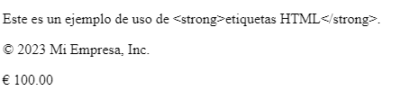
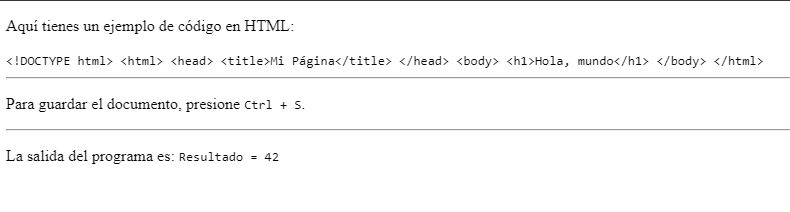

<h1 align="center">Codificaciones</h1>

<h2>📑 Contenido</h2>

- [Acrónimos](#acrónimos)
- [Entidades](#entidades)
- [Texto Maquina](#texto-maquina)
  - [code](#code)
  - [kbd](#kbd)
  - [samp](#samp)
- [Comentarios](#comentarios)

## Acrónimos

La etiqueta `<abbr>` se utiliza para definir una abreviatura o acrónimo. Esta etiqueta ayuda a los motores de búsqueda y a los navegadores a identificar el significado completo de una abreviatura o acrónimo y proporciona información adicional a los usuarios cuando pasan el cursor sobre la abreviatura. La etiqueta `<abbr>` se coloca generalmente alrededor del texto abreviado y se utiliza en combinación con el atributo `title` para proporcionar la expansión o descripción completa de la abreviatura.

```html
<!-- HTML -->
<p>
  <abbr title="Hypertext Markup Language">HTML</abbr> es un lenguaje de marcado
  utilizado para crear contenido en la web.
</p>
```

> [!TIP]
>
> Si lo que quieres es marcar el término que se quiere definir se puede utilizar
> la etiqueta `<dfn>` <br>
>
> Ejemplo: <br>
> El `<dfn>`HTML`</dfn>` es un lenguaje de marcado para hipertextos.

## Entidades

Las entidades(Entities) son secuencias de caracteres especiales que se utilizan en documentos HTML para representar caracteres que tienen significados especiales o que no se pueden mostrar directamente en el código fuente de HTML debido a su uso como marcas de código o símbolos reservados. Las entidades HTML permiten mostrar estos caracteres de manera correcta y segura en una página web. Cada entidad HTML está compuesta por un símbolo &, seguido de un nombre o número de referencia, y finalizada con un punto y coma ;.

**Ejemplos de entidades comunes:**

- `&lt;`: Representa el signo menor que <.
- `&gt;`: Representa el signo mayor que >.
- `&amp;`: Representa el símbolo de ampersand &.
- `&quot;`: Representa las comillas dobles " en texto.
- `&apos;`: Representa una comilla simple ' en texto.
- `&nbsp;`: Representa un espacio en blanco no rompible (non-breaking space), que evita que el navegador coloque un salto de línea o espacio en blanco adicional.
- `&copy;`: Representa el símbolo de derechos de autor ©.
- `&reg;`: Representa el símbolo de marca registrada ®.

```HTML
<!-- Ejemplo -->
<p>Este es un ejemplo de uso de &lt;strong&gt;etiquetas HTML&lt;/strong&gt;.</p>
<p>&copy; 2023 Mi Empresa, Inc.</p>
<p>&euro; 100.00</p>
```

**Resultado:**



## Texto Maquina

### code

La etiqueta `<code>` en HTML se utiliza para marcar fragmentos de código fuente, ya sea código HTML, CSS, JavaScript u otros lenguajes de programación. El contenido dentro de la etiqueta `<code>` se muestra en un tipo de fuente de ancho fijo (como una fuente de monoespaciado), lo que ayuda a distinguirlo del texto normal y facilita su identificación como código.

```html
<p>Aquí tienes un ejemplo de código en HTML:</p>
<code>
  &lt;!DOCTYPE html&gt; &lt;html&gt; &lt;head&gt; &lt;title&gt;Mi
  Página&lt;/title&gt; &lt;/head&gt; &lt;body&gt; &lt;h1&gt;Hola,
  mundo&lt;/h1&gt; &lt;/body&gt; &lt;/html&gt;
</code>
```

### kbd

La etiqueta `<kbd>` en HTML se utiliza para marcar texto que representa la entrada del teclado, como teclas individuales o combinaciones de teclas, en un documento web. Esta etiqueta es especialmente útil para mostrar comandos de teclado, atajos de teclado y cualquier tipo de entrada del usuario que involucre el teclado.

```html
<p>Para guardar el documento, presione <kbd>Ctrl + S</kbd>.</p>
```

### samp

El elemento HTML Sample (`<samp>`) se utiliza para incluir texto en línea que representa una muestra (o cita) de la salida de un programa de ordenador.

```html
<p>La salida del programa es: <samp>Resultado = 42</samp></p>
```

**Resultado:**



> [!NOTE]
>
> Es útil en la documentación técnica, tutoriales, guías de usuario...

## Comentarios

Los comentarios se usan para añadir información de lo que hace el código. Los comentarios solo son visibles para aquellos que dispongan del código fuente.

Comentario:

`<!-- Esto es un comentario en HTML -->`

> [!TIP]
>
> Atajo de teclado para VisualStudioCode ==> **Ctrl+k+c**


