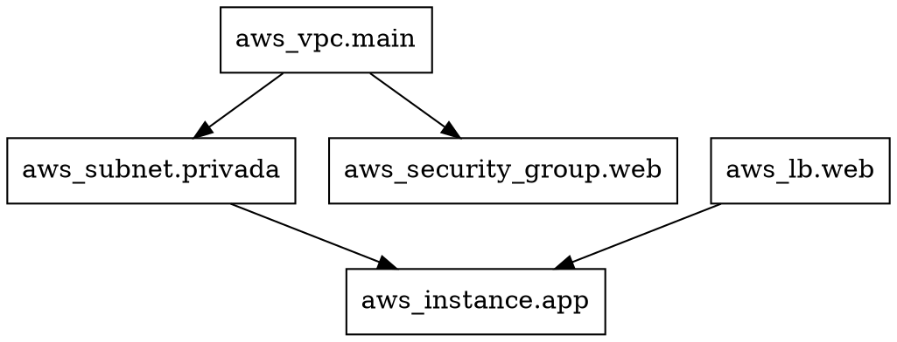

# Grafico de dependencias

Terraform modela todos los recursos de una configuracion como un grafo aciclico dirigido (DAG) cuyos vertices son recursos, modulos, data sources y provisioners, y cuyas aristas representan relaciones de dependencia. Este grafo es la estructura de datos fundamental que permite a Terraform determinar el orden de operaciones, identificar oportunidades de paralelizacion y detectar ciclos que bloquearian la ejecucion.

## El comando terraform graph

Terraform expone este grafo internamente a traves del subcomando `terraform graph`, que genera una salida en formato DOT, el lenguaje de descripcion de grafos del proyecto Graphviz. La salida puede redirigirse a un archivo y visualizarse con herramientas compatibles.

```bash
terraform graph > graph.dot
```

El contenido del archivo `graph.dot` tiene esta estructura:



Cada nodo representa un recurso y cada flecha una dependencia implicita o explicita. La direccion de las flechas indica el orden de creacion: si `A -> B`, entonces A debe crearse antes que B. Durante la destruccion, el orden se invierte automaticamente.

> El grafo puede ser muy grande en configuraciones con decenas o cientos de recursos. Es recomendable filtrar por recurso especifico con `terraform graph -type=plan` o procesar la salida con herramientas como `tgf` (Terraform Graph Filter) para visualizar solo subconjuntos del grafo.

## Visualizacion con Graphviz

Graphviz es un conjunto de herramientas de codigo abierto que procesa archivos DOT y genera representaciones visuales en formatos como PNG, SVG o PDF.

```bash
# Instalacion en Ubuntu/Debian
sudo apt install graphviz

# Instalacion en macOS
brew install graphviz

# Generar PNG a partir del DOT
terraform graph | dot -Tpng > grafo.png

# Generar SVG (escalable, mejor para documentacion)
terraform graph | dot -Tsvg > grafo.svg
```

Tambien es posible generar una representacion mas legible agrupando nodos por tipo de recurso o por modulo. Graphviz soporta subgrafos que Terraform utiliza para agrupar recursos dentro de modulos:

```dot
subgraph "module.network" {
  "[root] module.network.aws_vpc.main" [label = "aws_vpc.main"]
  "[root] module.network.aws_subnet.privada" [label = "aws_subnet.privada"]
}
```

Para visualizar el grafico interactivamente, existen herramientas online como `edotor.net` o `dreampuf.github.io/GraphvizOnline` que permiten pegar el DOT y ver el resultado al instante. En entornos de desarrollo locales, editores como VS Code cuentan con extensiones de previsualizacion de Graphviz.

```bash
# Convertir y abrir directamente en Linux
terraform graph | dot -Tpng | xdg-open -
```

El grafico revela de un vistazo la estructura de dependencias de la infraestructura. Un grafo con muchas aristas secuenciales indica una configuracion fuertemente acoplada que se ejecutara lentamente. Un grafo con multiples ramas paralelas indica oportunidades de optimizacion que Terraform aprovechara automaticamente.

## Paralelizacion segura

Terraform utiliza el grafo de dependencias para decidir que recursos pueden crearse en paralelo sin riesgo. Si dos recursos no tienen una ruta directa ni indirecta entre ellos en el DAG, pueden procesarse concurrentemente. El numero maximo de operaciones paralelas se controla con el flag `-parallelism`:

```bash
# Valor por defecto: 10 recursos en paralelo
terraform apply -parallelism=5

# Aumentar paralelismo para configuraciones muy grandes
terraform apply -parallelism=20
```

Ajustar el paralelismo es un equilibrio: valores altos aceleran las ejecuciones pero pueden saturar la API del proveedor cloud y provocar rate limiting. Los proveedores cloud tienen limites de peticiones por segundo, y lanzar demasiadas operaciones simultaneas puede resultar en errores `429 Too Many Requests`. En entornos con APIs restrictivas, reducir el paralelismo a 2 o 3 suele ser necesario.

> El paralelismo se aplica por separado a cada tipo de operacion (crear, actualizar, destruir). Terraform nunca ejecuta en paralelo operaciones sobre el mismo recurso ni operaciones que compartan una dependencia directa. La seguridad del grafo es estricta: si hay una arista entre dos recursos, jamas se procesaran al mismo tiempo.

La combinacion de `terraform graph` para inspeccion, Graphviz para visualizar y `-parallelism` para controlar la ejecucion proporciona un conjunto de herramientas para entender y optimizar el rendimiento de cualquier configuracion de Terraform.

